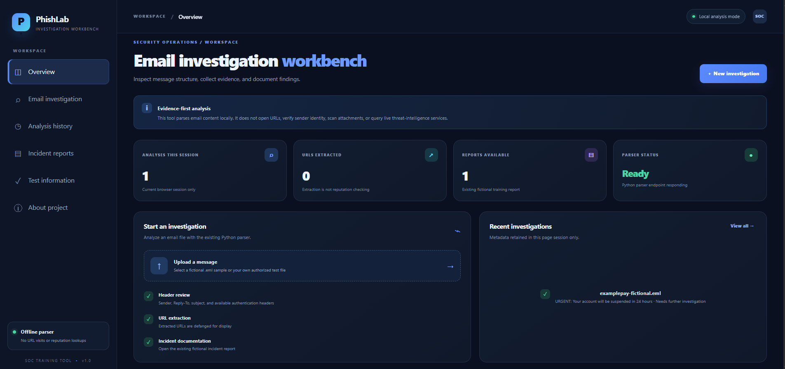
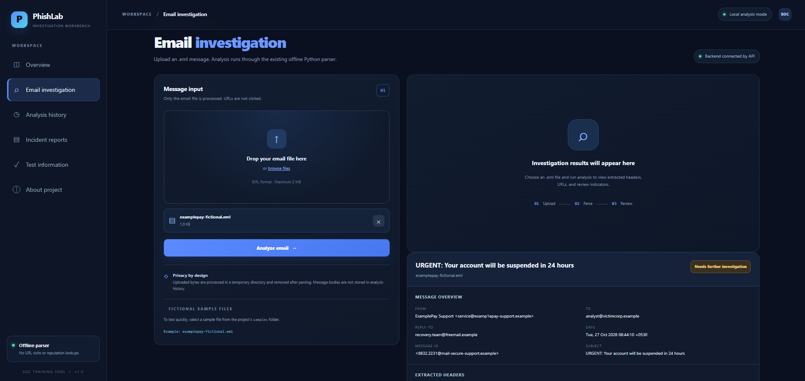
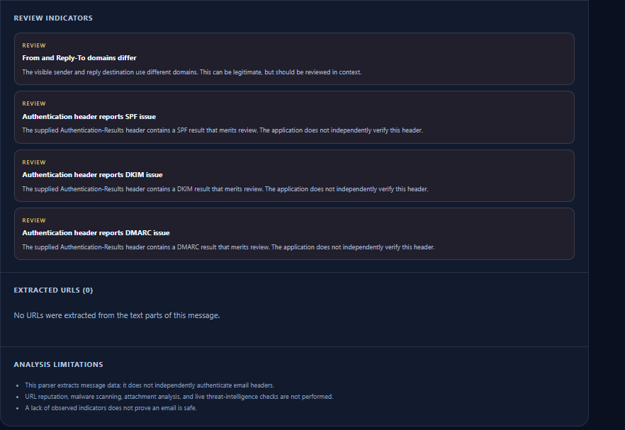
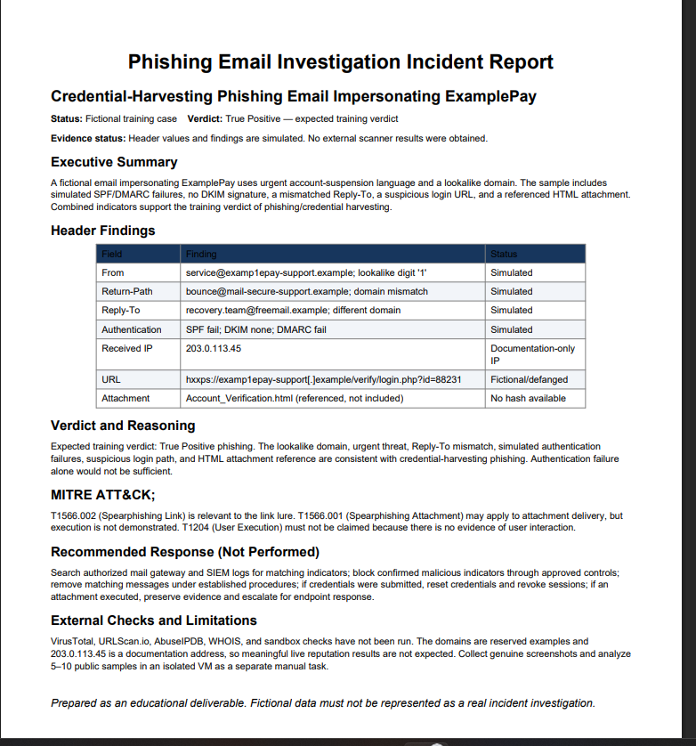

# Phishing Email Investigation and Incident Response Playbook — SOC Analyst L1

> Educational project based on the supplied six-page project guide. Fictional sample findings are clearly labelled. No real scanner results or screenshots are fabricated.

## Objective
Demonstrate a safe L1 workflow for triaging phishing emails, reviewing headers and SPF/DKIM/DMARC, investigating URLs and attachments, extracting IOCs, deciding a verdict, documenting incident response, and preparing evidence for a recruiter.

## Requirements checklist
- [x] Phishing basics and indicator checklist
- [x] Header field explanations and fictional ExamplePay walkthrough
- [x] URL/domain/IP reputation investigation procedure
- [x] Safe attachment inspection and hashing commands
- [x] IOC defanging helper and `.eml` parser
- [x] Analysis log template with sample rows labelled simulated
- [x] Incident response playbook and decision flow
- [x] Splunk example query from the reference guide
- [x] Incident report in Markdown and PDF
- [x] Screenshot checklist (actual external-tool screenshots remain pending)
- [x] Interview preparation and conditional resume wording
- [x] Unit tests for local helper functions
- [ ] Analyze 5–10 genuine public phishing samples in an isolated VM (manual task; not falsely claimed complete)
- [ ] Collect genuine VirusTotal, URLScan, AbuseIPDB, WHOIS, or sandbox results (manual task)
- [ ] Capture genuine screenshots from actual tools (manual task)
- [ ] Publish repository to user's GitHub (manual task)

## Project structure
```text
phishing-email-investigation/
├── README.md
├── app.py
├── Procfile
├── requirements-deploy.txt
├── templates/
│   ├── index.html
│   └── report.html
├── static/
│   ├── css/style.css
│   └── js/app.js
├── analysis-log.md
├── playbook.md
├── samples/
│   ├── examplepay-fictional.eml
│   ├── fake-invoice-fictional.eml
│   ├── fake-hr-fictional.eml
│   ├── password-reset-fictional.eml
│   └── benign-comparison-fictional.eml
├── reports/
│   ├── incident-report.md
│   └── incident-report.pdf
├── screenshots/README.md
├── src/analyze_eml.py
├── tests/
│   ├── test_analyze_eml.py
│   └── test_web_app.py
├── requirements.txt
└── .gitignore
```

## Setup
Python 3.10+ recommended. Core parser uses only the Python standard library.

Windows PowerShell:
```powershell
py -m unittest discover -s tests -v
py src/analyze_eml.py samples/examplepay-fictional.eml
```

Kali Linux / Ubuntu:
```bash
python3 -m unittest discover -s tests -v
python3 src/analyze_eml.py samples/examplepay-fictional.eml
```

The PDF report was generated using ReportLab. Rebuilding it requires:
```bash
python -m pip install -r requirements.txt
```

## Investigation workflow
1. Triage: record reporter, receipt time, recipients, subject, and whether anyone clicked or submitted credentials.
2. Headers: inspect From, Return-Path, Reply-To, Received, Message-ID, Authentication-Results, SPF, DKIM, and DMARC.
3. URL/domain/IP: defang IOCs before documentation; use VirusTotal, URLScan.io, AbuseIPDB, and WHOIS only with appropriate care.
4. Attachment: inspect as text; compute SHA-256 and confirm file type. Do not execute it.
5. Scope: search authorized mail gateway and SIEM logs for sender, subject, URL, and hash.
6. Verdict: combine evidence; a failed authentication result alone is not proof.
7. Respond: recommend containment and escalation; document actions actually performed separately from recommendations.

## Safety
- All included email samples are fictional training examples and use reserved `.example` domains/IP documentation ranges.
- Do not click links or open attachments from suspicious emails.
- Never upload confidential email or sensitive attachments to public scanners without authorization.
- Handle real samples only in an isolated VM with snapshots.
- Defang indicators in reports (e.g., `hxxps://evil[.]example`).
- Do not use this project to access systems without authorization.

## Tools referenced by the guide
Text editor/Thunderbird, MXToolbox Header Analyzer or Google Messageheader, VirusTotal, URLScan.io, AbuseIPDB, WHOIS/domain lookup, CyberChef, Any.Run or Hybrid Analysis, and an isolated VM. Tool availability, free tiers, and submission terms may change; check them before use.

## Example Splunk query
```spl
index=proxy url="*examp1epay-support*" | stats count by user, src_ip
```
This is a template from the project guide. Adjust the index and field names to match authorized logs. It has not been tested against a real Splunk dataset in this package.

## Evidence status
- **Completed locally:** project files, fictional samples, documentation, helper script, unit tests, Markdown report, generated PDF.
- **Simulated:** email headers and expected ExamplePay verdict.
- **Pending manual evidence:** actual scanner results, genuine screenshots, analysis of 5–10 public samples, and GitHub publication.


## Web application (Flask)
The project includes a Flask dashboard that reuses `src/analyze_eml.py`. The browser upload calls the real parser through `POST /api/analyze`; results are based on extracted headers and URLs, not mock analysis data.

### Run locally on Windows
From PowerShell:
```powershell
cd G:\phishing-email-investigation
py -m pip install -r requirements.txt
py -m unittest discover -s tests -v
py app.py
```
Then open `http://127.0.0.1:5000` in your browser. Stop the local server with `Ctrl+C`.

### Run locally on Linux
```bash
python3 -m pip install -r requirements.txt
python3 -m unittest discover -s tests -v
python3 app.py
```

### Web routes
- `GET /` — SOC-style dashboard
- `GET /health` — minimal backend health response
- `POST /api/analyze` — parse an uploaded `.eml` file
- `GET /reports/incident-report` — view the existing Markdown report as escaped plain text
- `GET /reports/incident-report.pdf` — view the existing PDF report

### Upload behavior and limitations
- Upload limit defaults to 2 MB. Set `MAX_UPLOAD_BYTES` as an environment variable to change it.
- Uploads are written to a temporary directory and removed after parsing; message bodies are not stored in history.
- Browser history stores metadata in page memory only and clears on reload.
- Extracted URLs are defanged for display and never visited by the application.
- Authentication results are read from the supplied headers; the application does not independently verify SPF, DKIM, or DMARC.
- The application does not perform URL reputation lookups, malware scanning, attachment execution, or live threat-intelligence checks.
- “No obvious indicators found” is not a safety guarantee. Treat all results as triage assistance, not a definitive verdict.

### Tests
Run all original parser tests and web tests together:
```powershell
py -m unittest discover -s tests -v
```
The web tests use Flask's test client. Do not report a passing result unless the command completes successfully in your environment.

### Render deployment preparation
The repository includes a `Procfile` using Gunicorn. In Render, create a new Web Service connected to the GitHub repository, select Python, set the build command to `pip install -r requirements-deploy.txt`, and use the start command from the `Procfile` (or enter `gunicorn app:app --bind 0.0.0.0:$PORT --workers 2 --timeout 30`). `requirements.txt` is for local Windows development; `requirements-deploy.txt` adds Gunicorn for the Linux hosting environment. Configure `MAX_UPLOAD_BYTES` only if needed. Do not enable Flask debug mode in production. Verify the deployed URL and upload a fictional sample after deployment; deployment has not been performed by this package-generation step.

Before pushing to GitHub, review `.gitignore` and ensure the repository contains no real confidential email, credentials, API keys, or sensitive logs.

## Screenshots

### Dashboard


### Email Investigation


### Review Indicators


### Incident Report (PDF)
